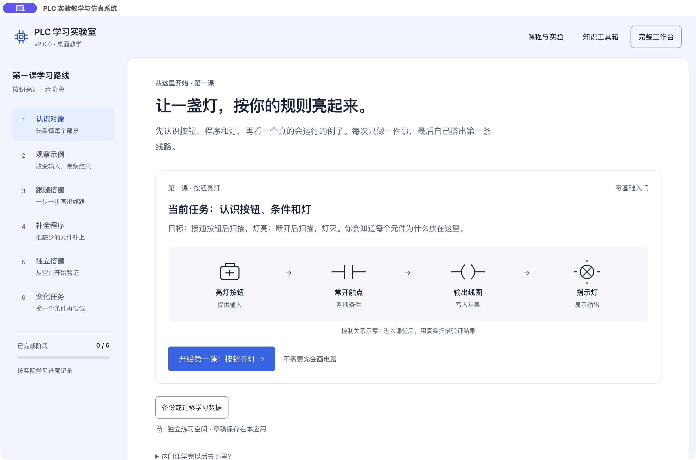
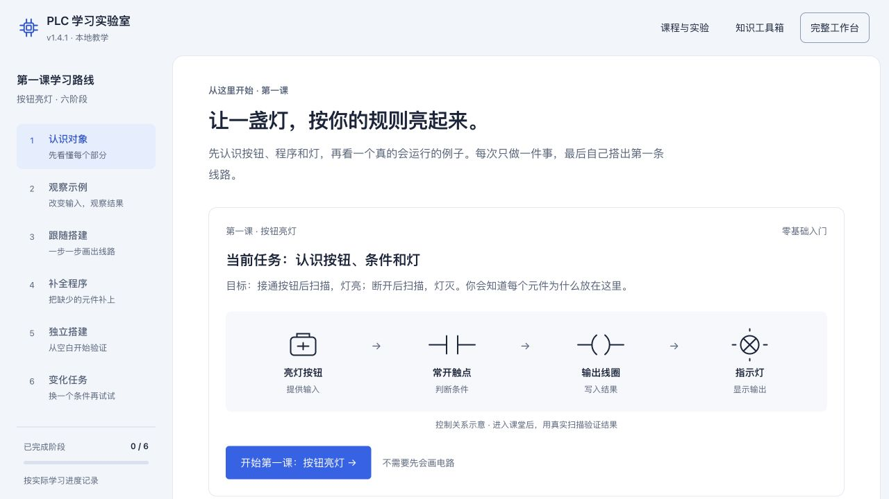

# PLC 实验教学与仿真系统

本机当前为 **2.0.2 · 布局修订，未发布**：学习页随窗口高度展开，放大线路和I/O观察区，阶段按钮位于页底；认识对象使用大符号讲解，答题时自动收紧说明。173项测试与原生全屏/数据保留检查通过，详见[布局修订记录](docs/LAYOUT_2.0.2.md)。GitHub公开下载仍为下方2.0.1。

2.0.1修订：首张对象默认已读，四项看完后出题；默认断开先预测扫描；第三阶段只搭建/检查；桌面观察线路与输入/结果同屏；点击梯形图元件可就近选择、命名和复用变量，下方属性保留。分阶段测试与限制见 [体验修订记录](docs/USABILITY_FIXES_20261025.md)。完整改动见 [2.0.1更新说明](docs/RELEASE_2.0.1.md)，远程源码与附件校验见 [发布核验](docs/PUBLISH_2.0.1.md)。

面向 PLC 零基础学生的本地教学工作台。版本 **2.0.2 · PLC学习实验室（本机布局修订）**。React + TypeScript + Vite + CSS + SVG，Electron封装独立桌面窗口。教学与仿真在本机执行，无服务器数据库、登录、付费 API 或实体 PLC 依赖；桌面应用内置运行环境，使用时不需要安装Node.js，也不需要联网。

2.0汇总自已存档1.3.0以来的教学主线、元件知识、界面、桌面封装和数据迁移改动。完整说明、兼容范围与已知限制见 [2.0更新说明](docs/RELEASE_2.0.0.md)，上传核验见 [发布记录](docs/PUBLISH_2.0.0.md)。新版应用下载见 [GitHub Releases · 2.0.1](https://github.com/skaid13/PLC-Learning-Simulator/releases/tag/v2.0.1)；当前仅提供Apple Silicon Mac构建，Windows/Intel Mac仍需自行构建并实测。下方1.4/1.4.1章节保留为迭代记录，属于本次2.0的组成部分。

依据用户提供的《PLC实验箱实验指导书0827.docx》，参考其中的 Rockwell **2080-LC50-24QVB** 和 BDT-PLC-A 实验箱。`SIM_*` 为本软件教学变量，`I-xx / O-xx` 为指导书端子标记。本软件不是官方 PLC 仿真器，JSON 不能下载到实体 PLC。真实指令语义和运动轴能力未作官方核验；支持的行为以 [执行规则](docs/ENGINE_RULES.md) 为准。

## 桌面应用：直接打开，退出即停止

**Mac：双击桌面的「PLC学习实验室.app」。** 当前已安装在 `/Users/skaid13/Applications/PLC学习实验室.app`，桌面图标链接到它。此包适用于Apple Silicon Mac，约297MB。没有终端窗口、浏览器标签或后台网页服务；红色关闭按钮及Command+Q都会退出整个应用，最小化只收起窗口。重复打开入口仍使用已有应用窗口。

原浏览器的5项学习数据已通过显式备份导入；退出、重新打开后导出核对完全一致。源备份保留在 `/Users/skaid13/学习用文件资料/PLC-浏览器学习数据-迁移前-20261021.json`，原浏览器记录未清理。应用数据固定保存在 `~/Library/Application Support/PLC-Learning-Simulator/`，升级或替换.app时保留此目录。

在首页点击“备份或迁移学习数据”，或使用应用菜单“学习数据”，可导出/恢复全部程序及进度。导入先预览、保留当前备份并确认，才替换文件内同名项；其它已有记录保留。单个程序JSON仍在完整工作台导入/导出。

2.0.1的30个测试文件171项功能测试、2项桌面路径测试、类型及Mac打包通过；本轮原生全屏、图上编辑、进度/草稿保留及菜单退出已实测。下述扫描/迁移/原生保存记录属于先前2.0验收。Mac实际打开、扫描、运行/停止/复位、原生文件保存/选择、迁移与重启恢复、关闭/Command+Q退出检查通过。旧4173服务已停止。按用户要求，旧网页启动入口、网页构建和重复打包临时文件已移入垃圾桶；共用界面源码、双平台桌面打包能力与学习数据保留。用户已授权以2.0更新GitHub。Windows/Intel Mac打包命令已保留，但未生成或实机验证；Mac包未签名/公证，下载后的系统安全提示与兼容性需由使用者按系统指引处理。详见[桌面应用记录](docs/DESKTOP_APP.md)与[清理记录](docs/CLEANUP_REPORT.md)。



### 从源码生成桌面应用

开发机需要Node.js 22.12或以上，执行 `npm ci` 后使用：

| 目标              | 命令                        | 产物与验收                        |
| ----------------- | --------------------------- | --------------------------------- |
| Apple Silicon Mac | `npm run package:mac`       | release/mac-arm64内.app，本机已测 |
| Intel Mac         | `npm run package:mac:intel` | x64.app，未生成/实测              |
| Windows x64       | `npm run package:win`       | NSIS安装包，应在Windows构建和实测 |

打包默认不发布。首次获取构建工具需要联网，生成后的应用可离线运行；普通使用者不需要开发依赖。备份文件与学习数据不要提交到仓库。

## 1.4.1 界面优化

保留六阶段学习、全部原实验与学生数据，统一蓝白配色、白色学习页和中文排版。首页路线显示真实完成阶段，当前任务与入课按钮集中呈现；按钮、触点、线圈、灯使用一致的SVG符号，结构示意与实际运行结果明确区分。

课堂保留真实目标高亮，说明在任务区显示，避免悬浮提示遮住扫描结果；预期结果与验证记录按需展开。知识工具箱在电脑上使用分组目录，在窄屏上使用主题选择；共享编辑器的辅助文字、选中、焦点和禁用状态更加清楚。没有新增联网依赖或修改扫描引擎、草稿格式、Mac/Windows启动脚本。

本阶段25个测试文件156项、类型/构建/格式、实际教学与375/390/768/1440布局检查通过；Windows实机和系统大字体仍待验证。此阶段原网页入口现已由桌面应用替代，所有界面改动纳入2.0。开发与恢复记录见 [1.4.1界面优化记录](docs/UI_UPGRADE_1.4.1.md)。



## 1.4 第一课试学版：从看懂到独立完成

默认进入唯一的新手学习首页，点击“开始第一课：按钮亮灯”。按照 **认识对象 → 观察示例 → 跟随搭建 → 补全程序 → 独立搭建 → 变化任务** 学习；每阶段明确当前位置、动作、原因和预期结果。按钮、触点、线圈和灯先逐个解释，再观察公共扫描引擎运行的示例。

第三阶段跟随搭建在检查结构通过后即可继续；补全、独立和变化阶段在结构检查后展开按钮/预测/扫描区。先预测亮或灭，再单步；接通和断开两种实际扫描都符合要求才能继续。错误预测给出实际输入、条件和结果；修改程序会复位并清除验证。独立练习按需打开三层提示，最终把常开改为常闭，验证相反规则。

上方“知识工具箱”统一说明输入/输出/内部变量、常开/常闭、线圈、串并联、保持、时间、计数、边沿和运行操作的用途、选择理由、区别、例子、错误与验证方法。原十课阅读、三个入门项目和11个正式实验从“课程与实验”进入；原有完整工作台仍可自由编辑。

教学草稿使用独立键 `plc-learning:first-lesson:v1`，每阶段各自保存，不覆盖原 `plc-learning-projects-v1`。退出保留草稿，刷新后从首页继续原阶段；不自动恢复运行或本次扫描证据。程序可导出为原schemaVersion 1格式；重建本阶段前确认并下载备份，可撤销。损坏教学记录保留原文，保存失败显示反馈并允许继续。

本阶段25个测试文件156项、类型/构建、实际六阶段页面操作、常开/常闭变式、恢复、JSON下载及桌面/窄屏检查通过。Windows实机、完整原生编辑/单程序JSON导入和真实零基础试学未验收。六阶段新流程目前仅覆盖第一课，其余实验保留原课程与引导；推广仍需根据试学反馈实施。此次教学主线纳入2.0，阶段证据与恢复方式见 [1.4学习主线记录](docs/LEARNING_PATH_1.4.md)。

## 1.3.0 文字基础课堂

点击工作台上方“文字基础课堂”，或入门地图的“基础课堂：从零打基础”。独立阅读窗口包含十课：PLC 的作用、变量、扫描、触点/线圈、串并联、保持、定时、上升沿/计数、顺序控制和调试验收。

每课按学习目标、正文讲解、逐步例子、自查问题/展开答案、易错点和实践入口组织。不需要先会电路或编程。章节可自由回顾，阅读位置及已读记录单独保存；已读不代表掌握。跳转项目保留各实验已有草稿。

建议先读第1～4课做按钮亮灯，第5课做停止条件，第7课做延时，第6/8/9课帮助衔接完整实验。最后用第10课的方法做独立变式验收。软件测试通过不能替代零基础学生的实际学习验证，也不能保证每个人独立完成全部11个实验。

本版包含1.2.0的全部功能，当前已验证144项测试。本机导入与实测记录见 [1.3.0 本机更新记录](docs/UPDATE_IMPORT_1.3.0.md)，课程设计见 [文字基础课堂更新记录](docs/FOUNDATION_UPGRADE.md)。

## 1.2.0 零基础学习入口

- 原“六步介绍＋一道题”替换为四个可展开的概念：PLC 的工作、输入输出与变量、梯形图、扫描与运行。
- 三个独立小项目：按钮亮灯、常闭停止条件、TON 两秒延时；各自保存草稿、引导进度与 JSON。
- 引导默认根据真实操作自动前进，不再每操作一次就点下一步。错误状态不推进；扫描步骤必须得到新的扫描结果。取消“完成操作后自动前进”可切成手动；回顾上一步自动暂停，偏好单独保存。
- 工具与选中元件旁可展开专属解析，包含逻辑、例子及易错点；覆盖常开/常闭、比较、普通线圈、SET/RESET、TON/TOF、周期脉冲、计数及运算。
- 入门卡片、任务/预测/观察分层展示，浮动提示缩小，窄屏保留当前任务与定位操作。原 11 个指导书实验保留。

更新检查、范围与接续方式见 [1.2.0 更新记录](docs/BEGINNER_UPGRADE.md)。

## 已实现功能

- 三栏工作台、教学/自由模式、11 个正式实验与3个入门项目选择、桌面编辑区调宽与窄屏自动堆叠。
- 十课文字基础课堂、三个入门小项目和11个完整分层课程：应用、先修知识、控制流程、I/O有效状态、设计理由、手动搭建、观察、故障、理解题与独立变式。
- 手把手真实操作检查：LED 19步，其余实验12步（水塔14步）；高亮目标、浮动提示、逐级提示、错误反馈、回顾/跳过/退出/恢复。
- 完整任务逐网络搭建清单：按需展开一个网络提示、准备内部变量、定位编辑器、与示例结构逐项对照，不自动填入程序。
- 课程已读、章节、引导和搭建位置单独保存；已读或完成基础线路练习不代表整项实验已掌握。
- 实际反馈区显示待采样输入、最后输出和真实写入网络，明确停止、复位与重建程序的区别。
- 图形梯形图：常开/常闭、比较、上升沿、串联/并联、多网络、名称、移动、删除、复制/粘贴、内部布尔/数值变量、结构检查与定位。
- 普通线圈、SET/RESET、TON/TOF、周期脉冲、CTU/计数复位、MOV/ADD；运行、停止、单步、复位和 1/5/20× 速度。
- 11 个输出驱动 SVG 面板；位置和液位自动反馈、可切换手动传感器、执行器卡滞及传感器冻结。
- “为什么这样运行？”使用真实扫描轨迹，显示触点读值、串联/并联结果、累计时间/次数、写入顺序和最终来源，支持定位网络及追踪内部变量。
- 每实验独立自动草稿、手动保存、50 步撤销/重做、JSON 导入确认/导出、格式和大小检查、存储失败反馈、损坏草稿原文备份下载。
- 参考程序需主动查看并确认载入；不会在空白学生工作区自动填入答案。载入后可继续编辑或撤销恢复。

## 从源码开发（macOS / Windows）

日常学习直接打开已安装的应用。开发机安装 Node.js 22.12 或以上版本（附带 npm），在项目文件夹执行：

```sh
npm ci
npm start
```

`npm start` 会先生成桌面资源再打开开发用桌面窗口，不再启动4173网页服务。`npm run build` 只生成 `desktop-staging`；打包命令见上方表格，生成的应用内含资源，可离线运行。清理构建暂存目录不会影响已安装的应用，下次开发或打包时自动重新生成。

Windows使用 `npm.cmd ci`、`npm.cmd start`，可避免PowerShell阻止 `npm.ps1`；在目标系统重新安装开发依赖，不共用Mac的 `node_modules`。Windows实机仍待验证。

`npm run dev` 仅供开发者调试共用界面源码，会启动临时Vite服务，需要自行停止。它不是已安装的网页版。原网页版的双击入口、静态服务器和根目录 `dist` 已退出当前交付，可从垃圾桶或历史提交 `76945c9` 恢复。不要清理浏览器中的原学习数据。

## 从零开始

1. 双击启动后，在学习首页点击“开始第一课：按钮亮灯”；返回学习可显示“继续第一课”。
2. 依次点按钮、触点、线圈、灯四张对象卡，读用途并回答问题。尚未认识时不用画线路。
3. 观察示例：接通亮灯按钮，先预测，再点击“预测后单步扫描”；断开后再预测/扫描，比较两种结果。
4. 跟随搭建：按当前任务高亮选择工具、放置元件、选择变量，再检查结构和实际验证。补全阶段只缺一个线圈；独立阶段从空白开始。
5. 变化任务把自己的独立程序复制到新阶段，要求断开亮、接通灭；先自己判断，不确定时再打开知识工具箱或分级提示。
6. 学完第一课进入停止条件、延时亮灯，再选择正式实验。其余实验继续使用分层课程、引导和逐网络搭建清单，暂未推广六阶段新流程。
7. 原有程序从“完整工作台”打开，保存、JSON导入导出、撤销重做、变量管理和参考程序保持。返回第一课保留工作台编辑历史；离开会停止连续运行。

停止保留最后状态，复位重置运行值和装置但保留程序。重建会替换程序，必须先确认和下载备份。程序编辑会复位；改变输入后需要新的扫描。教学解释和颜色以本软件实际轨迹为依据，不是实体PLC工程或真实电流。

## 11 个实验与教学选择

所有参考程序均为依据指导书要求独立编写的可读梯形图，装置不播放独立于程序的固定流程。指导书未给出的物理参数、频率和流程歧义，界面在“教学设定与边界”中明确列出。

| 实验            | 仿真和验证重点                            | 主要教学选择                                                                       |
| --------------- | ----------------------------------------- | ---------------------------------------------------------------------------------- |
| LED 数码显示    | A～H 单段、0～9/A/b/C/d/E/F 循环          | 每图案 1 秒，“逐段”按单段处理                                                      |
| 步进电机        | 脉冲边沿、方向、使能、角度                | SB1 启动/SB2 反向/SB3 使能；默认 400 脉冲=90°；400 ms 教学脉冲，不模拟 MC_* 运动轴 |
| 机械手          | 取件、5 秒夹紧/放松等待、传感器回原点     | 全程每方向 3 秒；停止清步骤，工件留在当前位置                                      |
| 交通灯          | 5/3/5/3 秒相位、红绿互锁                  | 黄灯每秒亮 200 ms                                                                  |
| 三层电梯        | 请求记录、到站清灯、位置反馈              | 相邻层 4 秒，空闲低楼层优先，无门控；RST 回一层                                    |
| 水塔水位        | 水池补水、水塔供水、低位持续 4 秒报警     | 水位归一化、缺水停泵、速率/阈值另列界面                                            |
| 天塔之光        | 指导书十一组循环                          | 每灯组 1 秒                                                                        |
| 液体混合        | A→B→搅拌3秒→排液→低位断开再2秒            | 液位阈值及流速为教学参数                                                           |
| 装配流水线      | 传送3秒、加工等待人工移位、入库           | 参考程序 C→G→H，明确补足正文与 I/O 的歧义                                          |
| 自动售货机      | 金额0～9、价格3/5元、出货5秒、退币        | 超额整枚拒收，出货中拒绝投币/退币，同时购买汽水优先                                |
| 配料/四节传送带 | 倒序5秒启动、故障/重物停机、缺料/满料全停 | A～D 对应 M1～M4；内部“重物模式”初值0为故障、1为重物；送料间隔5秒                  |

原文目标、控制要求和疑点保存在 [指导书提取记录](docs/MANUAL_EXTRACTION.md)，原 DOCX 内容未修改。教学选择不作为真实设备规格或指导书原文。

## 保存、备份与 Mac/Windows 迁移

- 每次程序编辑自动写入当前应用的本地存储；“保存草稿”手动再保存一次。状态区显示成功时间或失败原因。
- 桌面应用与原浏览器、不同地址和端口的草稿相互隔离；保留应用数据目录及原浏览器记录。迁移使用首页的全部学习数据备份工具。
- 在 Mac 点击“导出 JSON”，把文件复制到 Windows，在相同软件中点击“导入 JSON”，选择文件并确认。运行值、物理状态和撤销历史不导出，避免重新打开时自动运行。
- JSON 包含 schemaVersion、实验 ID、变量、网络、支路和指令；只用于本仿真器。限制 1 MB、500 个网络、500 个变量、每网络最多 8 支路、每支路最多 4 触点。
- 导入拒绝损坏结构、未知版本、重复标识或不匹配的物理 I/O。未绑定的编辑草稿可以导入，但需补齐后才能运行。
- 损坏的本地存储不会在打开页面时覆盖，提供原文备份下载；开始编辑后会用新的工作区自动保存。存储空间不足时请立即导出 JSON。
- 1.3.0 保持原 schemaVersion 1 程序格式，无需迁移；新增小项目JSON需1.2.0及以上版本。教学章节/引导进度单独保存在当前浏览器，不包含在程序 JSON 中；刷新不自动恢复运行。
- 撤销/重做只在当前打开的页面内保留，每实验最多 50 步。复制/粘贴网络在当前实验内使用，复制后应检查普通线圈是否重复绑定。

## 检查与测试

```sh
npm test
npm run typecheck
npm run build
```

1.1.0 基线为 19 个测试文件共 130 项；1.2.0 的最新检查结果见更新记录。测试涵盖基础编辑与教学、布尔/并联/计时/计数/运算规则、运行控制与计时器清理、实际轨迹解释、保存恢复/导入校验、参考程序往返，以及 11 个实验的典型控制流程。覆盖的是教学规则与列出的场景，不能替代工业设备验证。

1.1.0 已实际完成浏览器 LED 19步、步进12步全流程，检查全部11个课程、传感器模式门槛、刷新恢复、JSON下载/文件选择/导入确认，以及1600/1366/1024/768/390/320像素窗口布局。正式服务冷启动和复用通过；Windows实机和系统默认浏览器自动打开仍未验证。详细检查与限制见 [教学优化验收记录](docs/TEACHING_UPGRADE.md)。

## 结构

```text
PLC-Learning-Simulator/
.gitignore          依赖、构建、缓存与敏感文件排除规则
.prettierrc.json     格式配置
package.json        Node 要求、依赖和开发/测试/运行脚本
package-lock.json   精确依赖锁文件，Mac/Windows 安装依据
tsconfig.json       TypeScript 配置
vite.config.ts      Vite / Vitest 配置
index.html          桌面应用共用界面入口
desktop/            独立窗口、离线资源协议、路径校验、图标及桌面测试
electron-builder.yml  macOS / Windows桌面打包配置
src/data/           实验目录、基础课程、原理解检查、参考梯形图生成
src/teaching/       分层课程、真实操作规则、阅读进度、逐网络结构对照
src/editor/         不可变编辑模型、结构与类型校验
src/engine/         扫描、运行状态机、React 运行连接
src/simulation/     输出驱动的物理模型与传感器反馈
src/storage/        程序格式、JSON 校验和本地草稿
src/components/     编辑器、教学、SVG 装置、执行解释和文件工具
src/test/           测试环境
docs/               原始指导书、提取记录、执行规则、清理/上传/新版验收与截图
DEVELOPMENT_PROGRESS.md  最新恢复入口与测试检查点
DEVELOPMENT_LOG.md       开发历史、决策与验收限制
```

本项目是独立教学仿真系统，没有另行存在的官方 PLC 工程或硬件下载配置。PLC 变量、I/O 及参考程序在 `src/types`、`src/data`，可保存程序的版本化结构在 `src/storage`；这些均属于必须保留的工程源文件。

## GitHub 源码备份与恢复

上传保持原始文件目录和现有Git历史。现有GitHub仓库由用户主动设为Public，本轮保持可见性；用户授权以2.0更新。源码、配置、锁文件、测试和文档（包括原始DOCX）通过Git保存；构建产物、依赖、测试输出和凭据由 `.gitignore` 排除。Mac应用单独作为Release附件提供，不以应用压缩包替代源码目录。

从GitHub获取对应桌面版源码后，在项目目录执行 `npm ci`、`npm start`；或执行上方对应系统的打包命令。Windows使用对应的 `npm.cmd` 命令。无需开发的Apple Silicon Mac用户可从上方Release下载独立应用；Windows/Intel Mac目前需要自行构建。

学生草稿不属于源码目录，不能通过Git自动备份。请通过界面导出JSON，另外保存在个人备份位置；公开仓库不提交个人学习数据。

历史教学优化 **1.1.0** 已更新至开源仓库 [skaid13/PLC-Learning-Simulator](https://github.com/skaid13/PLC-Learning-Simulator) 的 `main`。用户已确认 Public 为主动设置；本次保持可见性，采用快进推送，保留全部阶段历史。新版功能提交为 `143c2ec`，初版仍可通过历史提交 `8e0baf8` 查看。仓库包含85个源文件/配置/测试/文档及截图，上传结果说明随后单独保存为文档提交。详见 [GitHub 上传记录](docs/GITHUB_UPLOAD.md)。

## 范围与后续

2.0基于已存档1.3.0迭代，保留 `d853626` 及更早全部提交，发布标签为 `v2.0.0`。旧网页运行构建和快捷方式已入垃圾桶。未实现实体PLC通信/下载、真实运动轴、任意嵌套梯形图或官方工程格式；这些不属于已授权的教学简化功能。没有云端服务、AI API或用户账户。发布记录、平台限制与恢复说明见 [2.0更新说明](docs/RELEASE_2.0.0.md)。

发现中断时先读 `DEVELOPMENT_PROGRESS.md`，检查 Git 差异、现有进程和测试，再从最后已验证检查点继续。清理只移动确认废弃的文件到 macOS 垃圾桶，不清空垃圾桶，不删除指导书、源码历史、依赖或当前构建。
