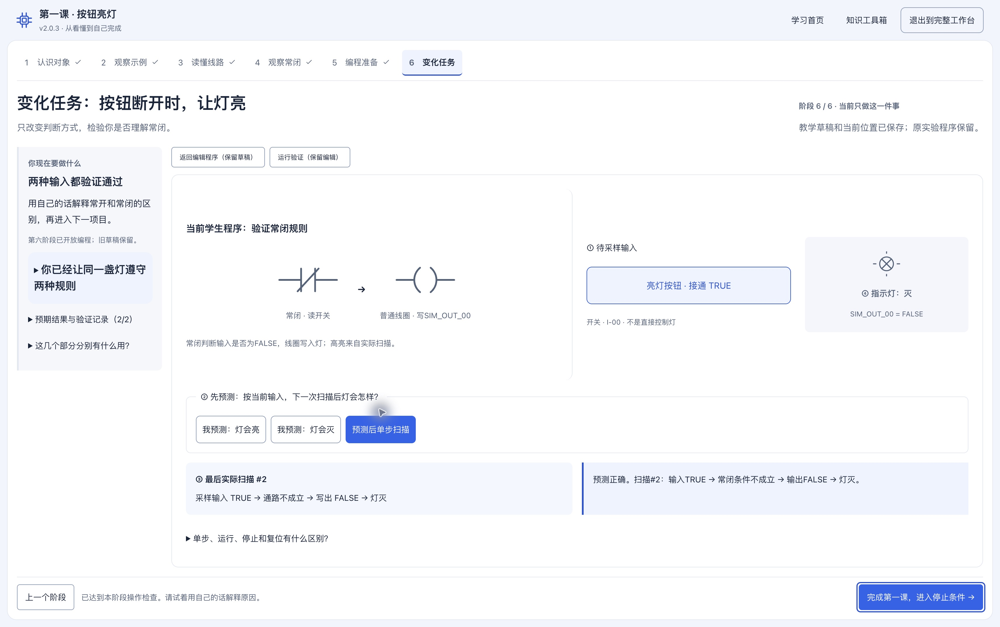

# 2.0.3 · 只读入门与第六阶段修复

2026-10-27本机交付。GitHub发布与下载核验见[发布记录](PUBLISH_2.0.3.md)。

## 本次修订

- 第一至第五阶段全程只读：认识对象→观察示例→读懂线路→观察常闭→编程准备；第六阶段才开放编程。
- 第三阶段不再重复第二阶段的亮灭操作，通过线路分工题衔接；第五阶段先确认常闭选择理由和变量绑定。
- 常开/常闭示例使用公共真实扫描引擎，两种输入都要正确预测并扫描；默认断开先扫描的步骤始终明确，复位灯灭不冒充验证。
- 第六阶段的具体动作始终显示。常开结构合法却不满足常闭任务时，明确说明原因，不提前开放运行验证。
- 图上可直接修改触点类型、变量绑定及名称，下方属性保留。观察区显示实际程序中的自定义变量名。
- 编辑、运行验证按当前任务切换，减少上下寻找；切换保留程序与当前扫描，真正编辑才取消旧证据并复位。完成反思按需展开。
- 前五阶段示范与旧学生程序隔离，旧草稿仍保留可导出；第六阶段恢复自己的旧草稿，新建时使用独立起点。程序/学习存储格式保持兼容。

## 第六阶段为什么卡住

实际旧草稿仍为常开，任务却要求常闭。旧版隐藏了修改提示，图上浮层没有类型选项，结构检查又允许先显示扫描区；继续扫描无法让常开成为常闭。没有发现前阶段程序共享引用污染的证据。按用户明确要求，现已额外锁定前五阶段编程。

打开桌面应用后点“继续第一课：变化任务”，再点触点，在旁边“图上触点类型”选常闭，点“检查结构”。保持默认FALSE预测灯亮并扫描；接通TRUE预测灯灭并扫描，即可完成。验收时的临时编辑已撤销，保留用户原草稿供亲手完成。

## 验证结果

最终31文件197项功能测试、2项桌面路径测试、TypeScript、正式构建、Prettier及Git差异检查通过。原实验、JSON导入导出、撤销重做、存储/恢复和引擎测试保留，没有删除有效断言来通过测试。

实际隔离页面走通六阶段、错误预测、图上命名和类型、撤销、编辑/验证切换与刷新恢复。1440×900观察/完成同屏，1280×720核心操作同屏；390页面无横向溢出，图上浮层可操作。窄屏、展开详细解释或复杂编辑区可自然纵向滚动，未用裁切隐藏内容。

Mac原生2.0.3验证包内多资源加载、保留原阶段6与别名、图上改常闭、FALSE亮/TRUE灭两次实际扫描、完成按钮启用、全屏观察/操作同屏。验收后撤销修改并恢复原学习位置。正常菜单退出后无主/辅助进程，清理重复构建后仍可重开。升级前保存窗口第一次禁用已取消，正常退出重开后成功保存；未将失败记作成功。

升级前/后原生导出各12922字节、5项记录。4项原始字符串相同；第一课记录JSON属性顺序经解析/重新保存规范化，5项解析后的全部字段完全一致。未将字符串不相同误称数据丢失或逐字节相同。

保留macOS/Windows打包入口与跨平台路径；Windows反斜线路径单测通过。Windows与Intel Mac实机/安装包、大字体和减少动画设置未在本轮实测；不宣称双平台实机验收完成。Mac包未签名/公证，继续作为教学仿真，不代表实体PLC的完整工程能力。

## 安装包与恢复

本机应用：`/Users/skaid13/Applications/PLC学习实验室.app`；桌面同名链接已核对。独立应用不需要终端或本地服务。

保留包：`release/PLC-Learning-Simulator-2.0.3-mac-arm64.zip`（129983252字节）。SHA-256：`163d0afcf4594eeed1b11260ebfa2d326dc02c5884a88a5c1b52854e90caf53a`。CRC、系统解包、版本及解包/安装asar一致通过。Python初次按中文ZIP路径定位失败、随后误匹配辅助app，最终使用主应用唯一层级匹配并核验；系统解包确认中文目录正常。

完整数据备份：`/Users/skaid13/Library/Application Support/PLC-Learning-Simulator-backups/before-2.0.3-20261027-230630/data`。JSON在Downloads中：`PLC-before-2.0.3-20261027.json`、`PLC-after-2.0.3-20261027.json`，均只在本机，不加入Git。

旧应用：`/Users/skaid13/.Trash/PLC-2.0.3-升级旧应用-20261027-230630/PLC学习实验室.app`；移入前后asar一致。另有7项、523文件、751475413字节重复构建/旧包/合成测试文件，均逐项摘要核对后移至垃圾桶。精确源/目标见清理报告。没有永久删除、清空垃圾桶、清理用户导出程序或卸载共享环境。

需要回退时先关闭新版并导出当前学习数据，再将垃圾桶中的旧.app恢复至安装路径。仅在需要恢复数据时，关闭应用后先备份当前数据目录，再从上述完整备份恢复，避免覆盖新学习成果。源码检查点3691f55、f993f19、c39056d、6cc1e2a及本次交付提交均保留。

