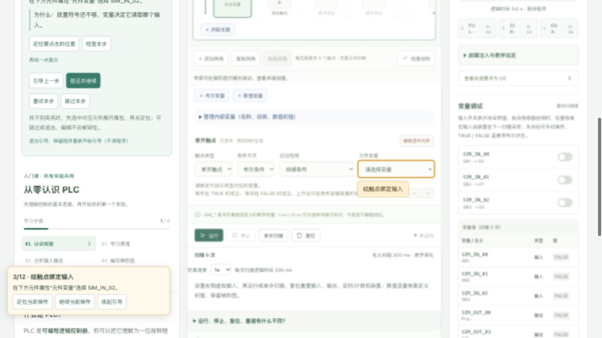
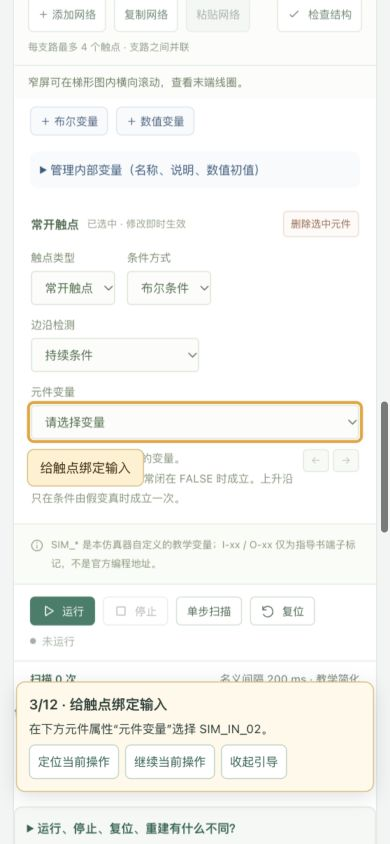

# 教学体验优化 1.1.0 验收记录

完成日期：2026-10-14。初版基线 `8e0baf8`，新版开发分支 `codex/teaching-upgrade`。保留同一项目、完整历史和已有学生程序格式。用户随后确认仓库由自己设为Public，并授权更新；1.1.0已快进合并并推送到远程main，功能提交 `143c2ec`，文档状态另存检查点。

## 自学路线

1. 从“从零认识 PLC”理解输入、输出、触点、线圈和扫描；进入“学习当前实验”，按需展开先修知识。
2. 点击“开始手把手引导”，按高亮定位进行一个主要操作。每一步解释操作及原因，“验证并继续”依据真实工具/程序/扫描状态检查。可以逐级求助、回顾、重试、跳过、退出和恢复。
3. LED先比较普通线圈与SET的松开结果。其余基础引导均明确为隔离线路练习，不把单网络练习当成完整定位、生产或售货任务。
4. 在“动手编程”展开完整任务的逐网络搭建。先准备变量名称/类型/初值，按需看一个网络的支路与指令参数，手动搭建，定位并对照结构。其它等价实现也可能正确；结构对照不代表整个任务验收。
5. 设置输入、单步验证，再连续观察。实际反馈区区分待采样输入、最近扫描输出和写入来源；执行解释仍使用公共引擎轨迹。
6. 完成专属理解题，再按独立变式的操作与完成标准自查。自然语言解释不自动评分；已读、跳过、载入参考都不等于独立掌握。

## 全部实验的教学重点

| 实验   | 主要新增知识与练习                                         |
| ------ | ---------------------------------------------------------- |
| LED    | 普通线圈/SET对比、24图案序号、段组合、常闭B段变式          |
| 步进   | 使能/方向/脉冲、CTU边沿、400脉冲90°、200脉冲45°变式        |
| 机械手 | 命令与到位、8动作步骤、夹紧保持、两次等待时间              |
| 交通灯 | 四相位、TON、红灯并联条件、互锁、7秒绿灯变式               |
| 电梯   | 请求记录、最近楼层、目标调度、到站清除、途中新增请求       |
| 水塔   | 有效低位信号、上下限滞环、缺水保护、4秒超时和卡滞诊断      |
| 天塔   | 11组序号、并联显示条件、RESET/SET顺序、单组加灯变式        |
| 混液   | SL2/SL1切换、搅拌3秒、低位断开后再排2秒                    |
| 流水线 | 自动传送与人工加工确认、移位上升沿、G衔接歧义              |
| 售货机 | 数值余额、价格比较、一次扣款、忙状态、拒收超额和退币       |
| 传送带 | 倒序启动、正常/故障/重物停机、停机前实际状态、无料满料优先 |

各实验均有完整输入端子的TRUE/FALSE含义和全部输出列表，教学设定保留原有显式边界，没有新增未经核验的实体PLC能力。

## 阶段检查点

| 阶段                 | 提交           | 测试结果                                  |
| -------------------- | -------------- | ----------------------------------------- |
| 0 基线与计划         | `0906180`      | 101项基线测试                             |
| 1 LED分层课程        | `0276bae`      | 102项及构建，课程/进度页面检查            |
| 2 LED操作引导        | `6ab628d`      | 104项及构建，19步浏览器全流程             |
| 3 实际反馈和完整搭建 | `fae4220`      | 106项及构建，扫描反馈/逐网络提示          |
| 4A 步进/交通/天塔    | `4f0271e`      | 114项及构建，三课程页面检查               |
| 4B 位置/液位反馈     | `b7096bc`      | 122项及构建，四课程/自动采样门槛          |
| 4C 生产类            | `7b5bb9d`      | 128项及构建，三课程页面检查               |
| 5 整体回归           | 本记录所在提交 | 19个文件130项、类型、构建、格式及差异检查 |

## 实际验证与限制

- 浏览器从零搭建LED基础网络，走通19步零跳过；验证接通/松开、SET重新绑定和真实“未写入、保留TRUE”解释。步进12步同样零跳过，使能输出通断来自扫描。
- 浏览器逐项查看11个课程；验证知识展开、已读进度、引导错误反馈及刷新恢复。丢失编辑器选中状态时明确提示重新选元件；不会自动覆盖程序或自动运行。
- 水塔自动传感器未关闭时引导不能推进；测试后恢复自动设置。
- 实际下载本轮步进练习JSON，再经原生文件选择、替换确认、导入恢复原网络；测试文件已移垃圾桶。程序依旧schemaVersion 1，学习进度独立保存，不随程序JSON跨电脑迁移。
- 测量1600×900、1366×768、1024×768、768×1024、390×844和320×700。修复320窗口溢出后无页面横向溢出；梯形图内部可滚动。变量定位检查中浮动提示未遮挡目标。截图仅证明所记录视图，不能代替所有浏览器和所有控件组合验收。
- Node正式服务4173冷启动及已有服务复用通过，开发服务5173已停止。Mac入口/服务脚本语法、桌面链接有效；测试采用`--no-open`，默认系统浏览器自动打开仍未验证。
- Windows保留同一源码、锁文件、跨平台Node入口及批处理，只有静态兼容检查，**Windows实机未测试**。
- 依赖版本未变；扫描引擎、运行状态机、参考程序、物理模型和存储格式未修改；原指导书SHA-256仍为`56f6af6b4b8ac21086aafa2ad8afef69c9862771800199267e9fdaf0abf7a30e`。
- 开发前远程main与初版基线相同；用户确认Public为主动设置，随后授权推送更新。新版已在远程main，保持Public与完整Git历史，没有上传个人学习数据。

## 验证截图

桌面：变量目标高亮、明确操作文本和可继续的浮动提示。

手机：单列布局，目标与提示互不遮挡。

## 中断恢复与清理

先读`DEVELOPMENT_PROGRESS.md`，检查当前分支、差异和已有服务，再从最近检查点继续。无需重新开发已验证阶段。初版保存在Git历史提交 `8e0baf8`，main已更新至1.1.0；不要用强制重置覆盖当前分支或用户草稿。

旧构建、测试文件与精确停止的进程见`CLEANUP_REPORT.md`，均未永久删除文件或清空垃圾桶。当前dist保留新版构建，可双击原快捷入口运行；缺失构建时执行`npm run build`（Windows为`npm.cmd run build`）。
